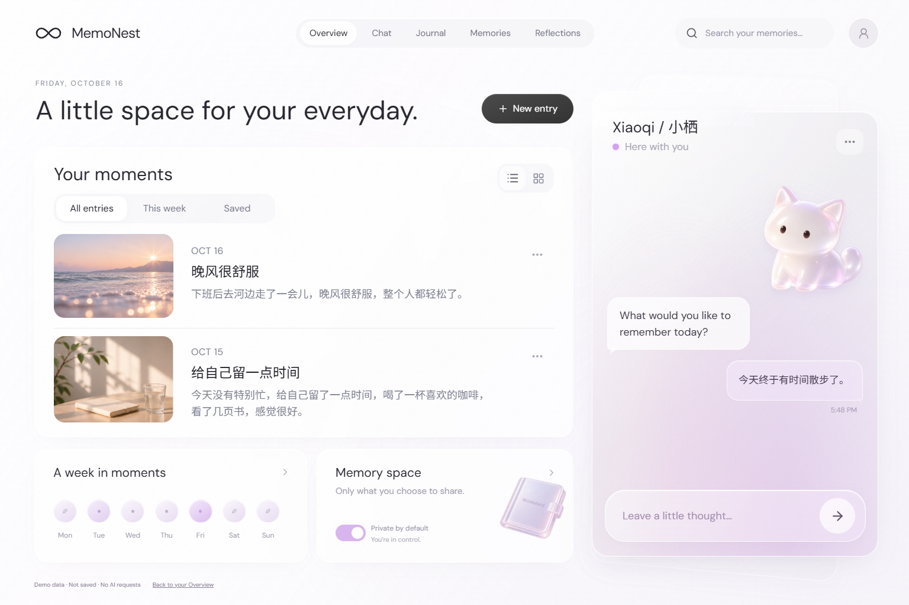
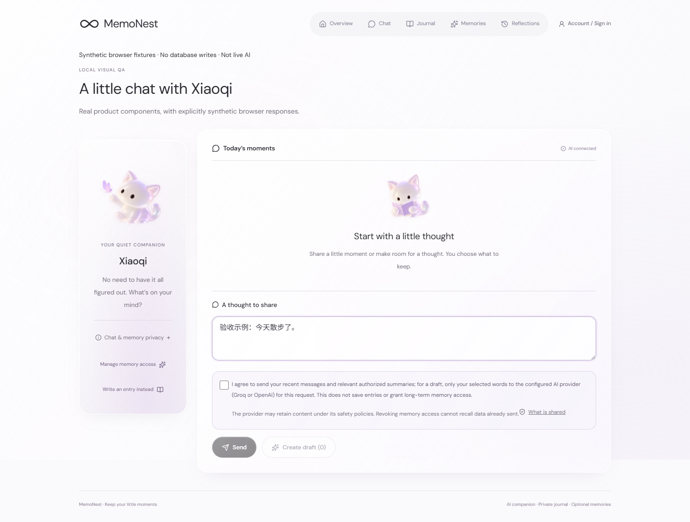
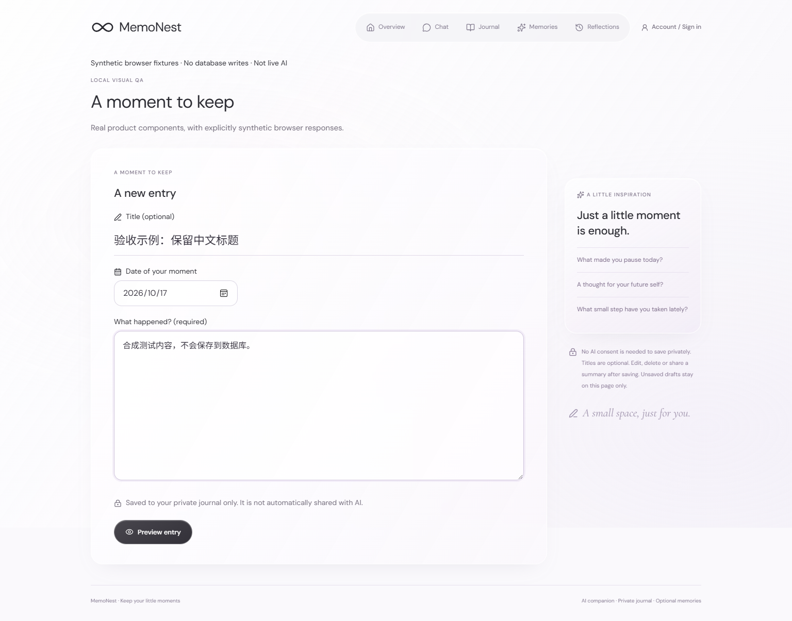
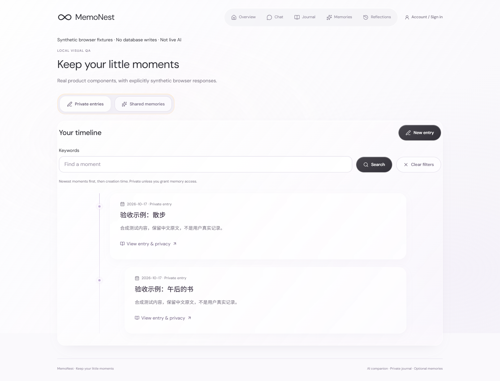
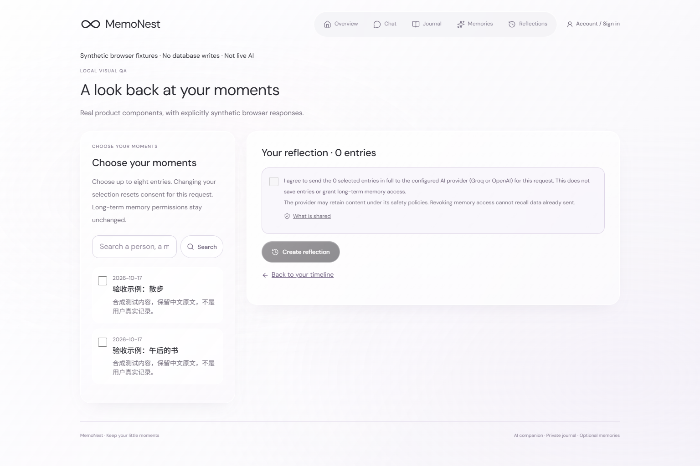

# MemoNest

### A little space for your everyday.

A private journal with an AI companion. Talk with Xiaoqi, turn selected thoughts into entries, and choose what becomes a memory.

[Overview](#overview) · [Chat](#chat) · [Journal](#journal) · [Memories](#memories) · [Reflections](#reflections)

## Overview

Your moments, weekly rhythm and memory controls in a white-and-lavender frosted-glass space.



> Actual local browser captures: Overview uses the reference demo; other pages show product components with labelled synthetic responses. All content is fictional. Screenshots do not prove live AI or authenticated saving. Demo photos are not an upload feature.

## Chat

Share a thought, select your words and review an editable draft before saving. Grounded replies offer source links. Chat clears when you leave or refresh.



## Journal

Write without AI. Add a date and optional title, preview, then save privately. Edit or delete entries; failed saves retain the draft for retry.



## Memories

Search your timeline. Separately share an exact summary with Xiaoqi, or revoke access while keeping the entry. Source edits and deletion invalidate old memories.



## Reflections

Choose up to eight entries and consent to one-time processing. Check the resulting quotes and source links. Reflections are not automatically saved or granted memory access.



## Meet Xiaoqi · 小栖

A quiet, pearl-white companion. Playing and Reading poses appear within Chat, shown above; Overview keeps the original sitting pose.

## Privacy by choice

- **Save privately:** entries belong to your account, without automatic AI access.
- **Consent per request:** send the stated messages, authorized summaries or selected entries only for that task.
- **Share a memory:** authorize a specific summary and source version; revoke it independently of the entry.

Revocation cannot recall data already sent or replies already shown. Requests use `store=false`, but provider retention policies still apply. AI output needs review.

## Built with

**Next.js · React · TypeScript · Tailwind CSS · Lucide · Supabase Auth / PostgreSQL · Groq / OpenAI · Zod**

RLS, restricted RPCs, version checks and idempotent writes protect account-scoped data. Recall uses keyword matching over authorized summaries.

## Run locally

Use Node.js 24. Follow [Supabase setup](docs/SUPABASE_SETUP.md) and [Groq configuration](docs/GROQ_INTEGRATION.md). Create `.env.local` from `.env.example` only if absent. Never commit credentials or reset existing data.

```bash
npm ci
npm run dev
```

<details>
<summary>Development checks</summary>

```bash
npm run lint
npm run typecheck
npm run test:core
npm run test:server
npm run build
npm run test:core:browser
```

Browser tests require Playwright browsers; mock tests do not prove live service success.

</details>

## Verification & limits

As of **October 17, 2026**:

- **Engineering:** lint, types, build, 61 core/server/AI tests and CI browser checks passed. [Acceptance](docs/NAVIGATION_CHARACTER_ACCEPTANCE.md).
- **Live workflow:** email confirmation remains unresolved; the latest hosted login → AI → save → memory/revoke → reflection flow has not been reverified. [Investigation](docs/AUTH_EMAIL_DIAGNOSTIC.md).
- **Deployment & research:** no confirmed public deployment or validated user-research outcomes.
- **Attachments:** no upload pipeline; original-photo recovery is unverified. Default covers are display-only.

[Product brief](docs/PRD.md) · [User flow](docs/USER_FLOW.md) · [Research plan](docs/USER_RESEARCH.md) · [Screenshot provenance](docs/screenshots/current/CAPTURES.md)

Historical technical documents and acceptance records remain in `docs/`.
