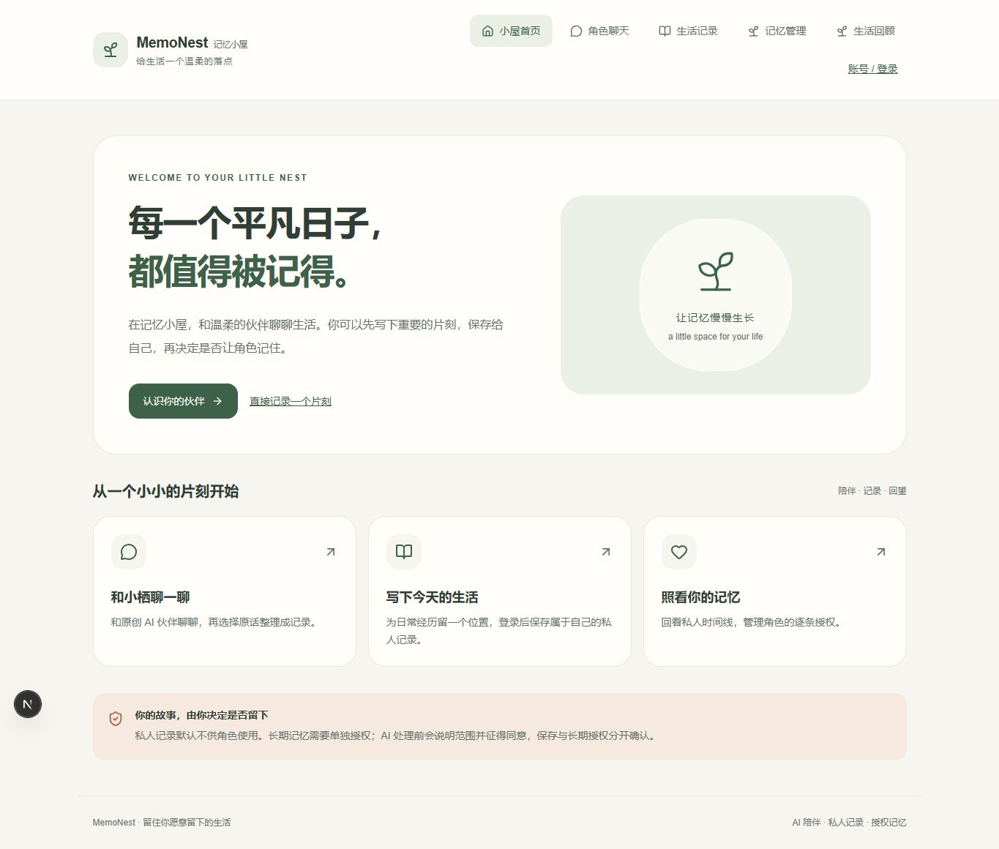
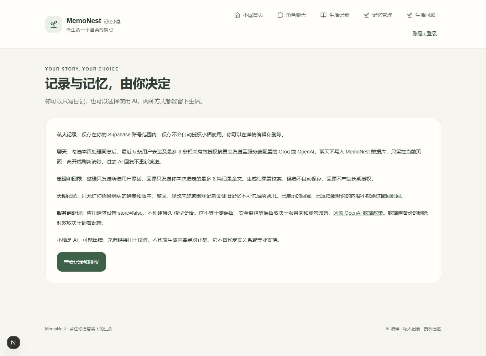
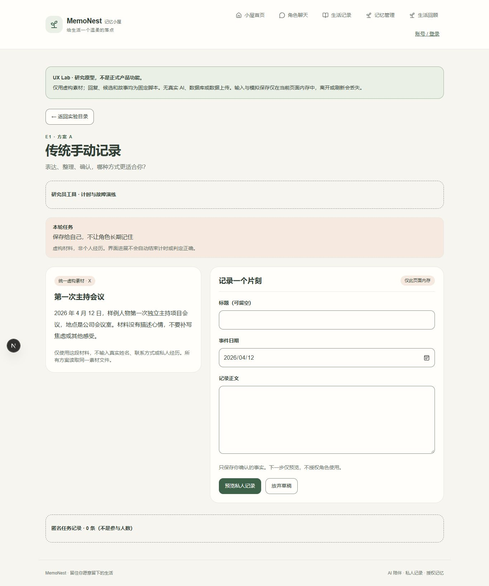
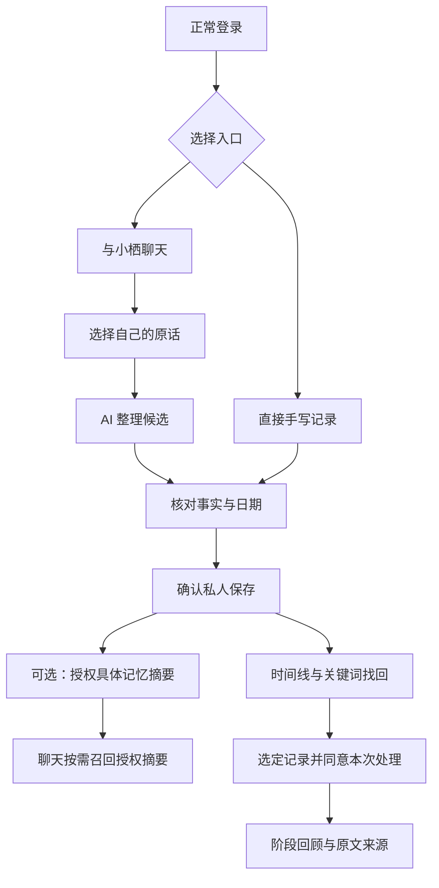

# MemoNest｜AI 角色陪伴式生活手帐

**通过对话表达生活，由自己确认记录，再决定哪些经历可以被 AI 记住。**

MemoNest 将原创 AI 伙伴「小栖」、生活记录整理、私人保存、授权记忆与阶段回顾串成一个产品闭环，同时保留直接手动记录入口。核心流程已通过本地真实验收；公开生产部署和真实用户研究尚未完成。

这是面向 AI 产品运营、AI 产品助理岗位的个人产品实践作品，展示需求拆解、交互取舍、AI 任务设计、隐私机制、技术协作与验收管理。开发使用 Codex 辅助实现、调试和测试，不将 AI 辅助代码包装成全部独立手写。

## 产品定位与用户问题

目标用户假设：希望保留日常，但不习惯持续写长文的成年学生与初入职场者。以下问题是设计假设，未通过真实访谈或规模化使用验证。

| 用户问题假设 | 产品设计回应 |
| --- | --- |
| 想记录，却不想从空白页组织语言 | 自然讲述后主动选择原话，让 AI 整理可编辑候选 |
| 担心 AI 猜测被保存成事实 | 展示原话依据，用户校对正文并确认事件日期后才保存 |
| 想保留经历，但不希望 AI 以后提起 | 私人保存与长期记忆授权分开，默认不授权 |
| 回顾文字好看，却找不到实际经历 | 时间线与关键词检索；阶段回顾附逐字引用和来源入口 |

产品目标是「正确留下、找回并控制生活记录」。聊天量和授权数量不能直接证明用户价值；是否降低记录负担仍需后续对照研究。

## 真实界面截图

以下截图来自本仓库页面的实际本地运行，使用临时无登录浏览器；没有植入或修改页面结果，没有私人记录或账号信息。

### 产品首页：聊天与直接记录并行



### 隐私说明：私人保存、单次处理与长期授权分开



<details>
<summary>查看 UX Lab 的记录流程研究原型</summary>



这是实际运行的研究原型，使用仓库自带虚构素材、固定脚本和页面内存，不代表正式数据库保存或真实 AI 输出。没有开展真实用户研究，截图中的任务记录数也不是参与人数。

</details>

正式账号页面未用于公开截图，以避免展示私人经历；真实功能验收与截图展示范围分别说明。

## 核心流程与能力



| 能力 | 已实现的交互与边界 |
| --- | --- |
| AI 角色聊天 | 小栖保持温暖、简洁，明确 AI 身份；回复可展开来源，不假装真人或制造排他关系 |
| 生活记录整理 | 只选用户原话，候选可编辑、可放弃；日期由用户确认，不自动保存 |
| 私人记录管理 | 输入、预览、保存、检索、编辑、删除；失败保留当前草稿，幂等重试避免重复保存 |
| 授权记忆 | 在详情页另行确认具体摘要，可修改或撤回；普通聊天不读取全部私人记录全文 |
| 阶段回顾 | 选择最多 8 篇记录，经单次全文处理许可后生成；提供逐字引用与来源，不自动保存或授权 |

聊天是当前页面的临时、非流式交互，刷新或离开不承诺恢复完整历史。生成结束后复核来源，再展示结果。手动记录无需经过聊天或同意 AI 处理。

## AI 设计与隐私机制

| 许可 | 数据范围 | 结果 |
| --- | --- | --- |
| 私人保存 | 用户确认的生活记录 | 保存给本人，不自动进入角色记忆 |
| 单次 AI 处理 | 本次明确选择的原话或记录 | 内容发送给对应模型服务商，不因此获得长期授权 |
| 长期记忆授权 | 明确确认的摘要与源记录版本 | 小栖可在后续聊天按需使用；可撤回，私人原记录保留 |

- 聊天、整理与回顾分别定义任务指令及输出契约，模型不具备保存、授权或数据库操作工具。
- 服务端执行身份、同源、账号标记及来源版本校验；Supabase RLS 与受限 RPC 约束用户数据访问。
- 记忆采用有效授权摘要的关键词匹配，最多召回 3 条；未命中不扫描私人全文，不宣称向量或语义检索。
- 引用必须匹配允许的来源 ID 和逐字片段；来源或授权在生成中变化时丢弃结果。来源存在性检查不能证明概括绝无语义偏差，仍需人工校对。
- 编辑或删除来源会使旧记忆失效；撤回不能追回已发送给服务商或已展示的内容。
- 模型密钥只在服务端使用。请求设置 `store:false`，但这不等于服务商零保留；日志不输出私人正文、完整上游响应或密钥。

## 技术架构

| 层级 | 实现 |
| --- | --- |
| 前端 | Next.js App Router、React、TypeScript、Tailwind CSS |
| 身份与数据 | Supabase Auth、PostgreSQL、RLS、受限 RPC；幂等操作与版本检查 |
| AI 服务 | 新增聊天、整理、多篇回顾优先使用 Groq Responses API，支持显式 OpenAI 配置；失败不静默切换到付费服务 |
| 输出控制 | 根据 Groq 模型能力选择严格 JSON Schema 或 JSON Object，统一执行 Zod 与来源校验，拒绝不完整、拒答及非法结果 |
| 可靠性 | 超时、取消、响应大小上限、每用户每进程限流、生成后来源复核 |
| 工程验证 | Node Test、组件测试、隔离 PGlite、Playwright 和 GitHub Actions |

旧单篇回顾保留已有 OpenAI 契约，与多篇阶段回顾是不同接口。进程内限流不能替代公开多实例部署的共享限额。

## 真实验收与证据

| 项目 | 当前结果 | 证据范围 |
| --- | --- | --- |
| 正常登录后的 AI 聊天 | 本地真实成功 | 已观察会话 HTTP 200、聊天 HTTP 200，真实 Groq 回复通过结构校验 |
| 整理与保存、阶段回顾、授权记忆读取 | 本地验收成功 | 项目负责人已实际操作并确认；不公开私人操作内容 |
| PR #12 | 已合并，CI 成功 | Lint、类型检查、核心/服务端测试、生产构建及核心浏览器测试通过 |
| 产品效果与用户研究 | 尚未验证 | 没有访谈人数、留存、转化、满意度或负担改善数据 |
| 公开部署与完整安全验收 | 待完成 | 本地验证不等于公网部署、托管双账号隔离与生产安全验收 |

验收日期：2026-10-12。本地真实功能验收先于 PR #12 合并；该 PR 的云端 live smoke 曾因缺运行时凭据退出，不能算模型成功。合并后代码的工程检查与既有本地真人结果分别列示，不声称重跑了完整托管真人链路。

证据：[PR #12](https://github.com/syuaetoo-svg/MemoNest/pull/12) · [PR #12 CI](https://github.com/syuaetoo-svg/MemoNest/actions/runs/38235803846)。最终文档与展示 PR 的验证结果见仓库合并记录。

本地 Groq 403 曾通过「会话 → 业务接口 → 网络 → 模型请求 → 输出」分层对照定位：Node 直连与浏览器现有代理的路径不同，同一密钥和请求通过现有代理后成功。Windows 自动代理启动修复位于 [PR #13](https://github.com/syuaetoo-svg/MemoNest/pull/13)，目前尚未合并，不能声称 main 已包含该启动方式。需要代理的环境应在启动时显式配置合法、受控的 Node 网络路径。

## 产品设计与运营展示

- [精简 PRD](docs/PRD.md)：用户问题假设、范围、关键取舍、验收规则和指标口径。
- [用户流程](docs/USER_FLOW.md)：聊天整理、私人保存、授权撤回和回顾的状态转换。
- [UX 对照实验](docs/UX_EXPERIMENTS.md) 与 [研究计划](docs/USER_RESEARCH.md)：保留研究方案，明确尚无真实样本或结果。
- [Groq 接入说明](docs/GROQ_INTEGRATION.md) 与 [Supabase 配置](docs/SUPABASE_SETUP.md)：实现与运行边界。

项目展示从需求到交付的拆解能力、AI 角色/任务边界设计、权限风险识别、故障定位及证据管理。拟评估正确保存与找回、权限理解、事实支持性等指标；这些是待执行的评估口径，不是已取得的业务成果。其他阶段文档保留历史说明，当前实现以代码、本 README 和精简设计文档为准。

## 本地运行

推荐 Node.js 24。首次配置时在本地复制 `.env.example` 为 `.env.local`，已有文件不要覆盖。

```bash
npm ci
npm run dev
```

配置服务端 `SUPABASE_URL`、`SUPABASE_PUBLISHABLE_KEY`、`APP_URL`、`GROQ_API_KEY` 与 `GROQ_MODEL`；OpenAI 使用独立配置。真实值只放本地或运行环境，禁止提交。已有数据库不要重复初始化或 reset，参考接入说明核对迁移。

```bash
npm run test:core
npm run test:server
npm run lint
npm run typecheck
npm run build
npm run test:core:browser
```

浏览器测试需安装 Playwright 浏览器。`npm run test:ai:live` 使用虚构材料及认证/数据库夹具，需要安全注入运行时凭据，不读取 `.env.local`，也不替代真实登录和持久化验收。

**交付范围冻结：不再扩展功能。** 公开材料仅包含匿名页面和虚构素材，不上传个人记录、API Key、Cookie、账号凭据或私人截图。
