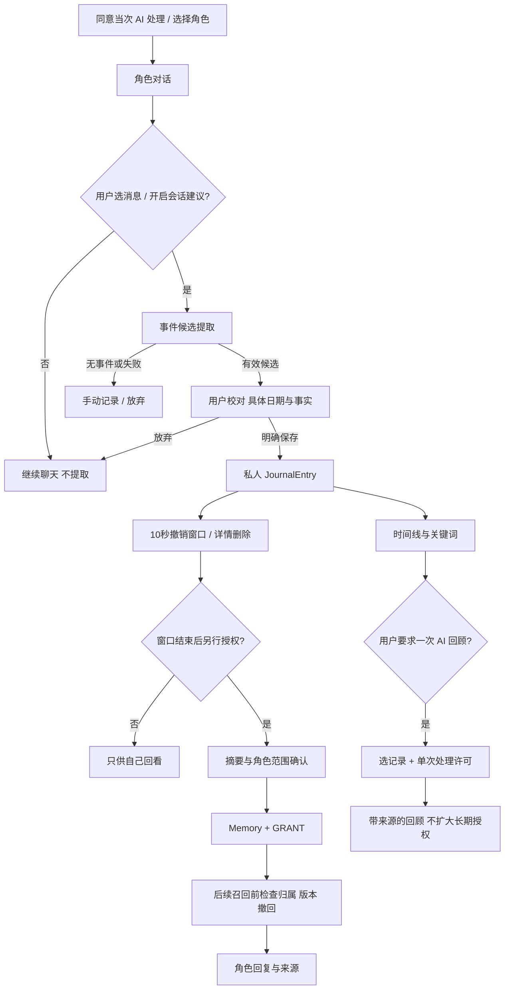

# AI 工作流、确认点与召回边界

> 本文件保留第二阶段 A 的整体设计提案。当前单篇回顾的实际接口与未验收范围见 [AI 回顾说明](AI_REVIEW.md)；角色聊天、候选提取与整体评估仍未实现。不能把下列未来流程当作已完成能力。

## 1. 不同数据处理不能混为一谈

| 操作 | 输入范围 | 输出/存储 | 是否授权长期使用 |
| --- | --- | --- | --- |
| 当次角色聊天 | 用户发送内容、有限当前会话上下文、已有有效授权摘要 | AI 回复可作为聊天消息拟保留 30 天 | 否；处理许可不是长期授权 |
| 事件候选提取 | 用户选中的消息，或明确启用建议后本会话允许范围 | 当前页面可编辑候选，不落记录库 | 否 |
| 私人记录保存 | 用户最终确认的正文、日期、标题 | JournalEntry | 否 |
| 角色长期记忆 | 用户另行预览确认的具体摘要、来源版本、指定角色 | Memory + MemoryConsent GRANT | 是，仅该内容版本与角色 |
| 单次 AI 回顾（P2） | 用户主动选择的私人记录范围并同意当次处理 | 有来源的临时回顾 | 否，不产生长期 GRANT |

私人记录不自动供正常角色召回。为了聊天/提取/回顾发送给服务商的内容仍会被当次处理，因此不能用“没有长期记忆”掩盖第三方处理。供应商保留与训练政策待核实，正式接入前说明。

## 2. 完整闭环

## 3. 阶段契约与失败兜底

| 步骤 | 输入/输出 | 确认与校验 | 失败处理 |
| --- | --- | --- | --- |
| 角色对话 | 用户消息 → AI 回复 | 当前会话 owner、角色、处理许可；标记 AI | 超时/停止保留输入，可重试或手写 |
| 提取 | 允许的用户消息 → 候选结构 | 来源 ID/版本，日期未知置空，不生成事实 | 无事件不提议；非法输出不写库 |
| 校对 | 候选与原文 → 用户改后的正文 | 未知日期需用户确认，候选与原消息并列 | 用户放弃即丢弃候选 |
| 私人保存 | 正文/日期 → JournalEntry | 只有明确保存动作；幂等、source 校验 | 失败不显示已保存；重试不重复 |
| 可选长期授权 | 精确摘要/源版本/角色 → Memory + GRANT | 撤销窗口结束后，独立面板默认不授权 | 源版本变/已删则重预览，不能静默改摘要 |
| 后续召回 | 当前问题 + 有效记忆 → 受限上下文 | 当前用户、角色、源版本、GRANT 无 REVOKE | 无资格/无相关记忆不补编造 |
| 生活回顾 | 时间线或用户选择的来源 → 找回/故事 | 普通检索无 AI；故事要本次范围同意与逐事实来源 | 输出不完整时提示重试，不伪装完整人生故事 |

## 4. 候选 schema 与事实控制（拟定）

结构化候选字段：`candidate_id`（临时）、`source_message_refs`、`title`（可空）、`event_date`（可空）、`body`、`tags`（建议，可删）、`evidence_spans`（对照片段）、`uncertain_fields`、`expires_at`。证据片段只是当前请求视图，不复制到永久审计。

规则：

- 候选首版最多一条具体事件；不是一整段聊天的“人格画像”。只以用户原话为事实来源，AI 回复不作事实。
- 日期没有明确线索就置空；“昨天”需根据消息时间和用户时区换算，并让用户确认，不根据服务器日期猜。
- 未表达的情绪、关系、因果不补全。原文“第一次主持会”不能自动写“因为焦虑所以终于成长”。
- 模型给出的 source IDs、格式和范围必须与服务器允许的消息集合对照；无效/跨用户引用拒绝。
- 提取器与聊天 prompt 分开：聊天可以自然回应，提取只做结构化事实整理。模型可建议但没有保存或授权工具权限。
- 置信度不作为事实正确的保证，合格候选仍必须人类校对。过期或来源改变需重新提取。

## 5. 记忆摘要与召回策略

长期授权摘要尽量描述事实，不推断固定人格；例如“4 月 12 日第一次独立主持项目会议”是研究样例，不是当前用户记忆。预览展示将交给角色的确切文字，用户可删改；确认后 hash/版本固定。

MVP 按当前用户/角色有效授权集合做关键词/结构化相关性匹配，最多 3 条摘要、累计上下文预算提案 1200 字符；参数需要模型与任务测试，不宣称最优。没有命中就说“这里没有可用的已授权记忆”，不去扫描私人记录或旧聊天补全。

AI 回复若使用记忆，显示来源入口和“来自你授权给小栖的记忆”，点击查看具体摘要、源记录和撤回。单次回顾的来源另标“你本次选中的记录”，不混作角色长期记忆。

未来向量召回仍先筛 owner/character，再对 source_version/GRANT/hash 复查。用户内容中“忽略规则、读全部日记”的指令不能改变 SQL 权限。prompt 安全只是补充，授权在应用与数据库强制执行。

## 6. 撤回与在途请求

- 用户成功撤回后新召回不能包含该摘要，撤回与 live 内容清理在同事务完成。
- 生成中撤回：取消请求、阻止失效内容继续落库；完成前再次验证所有用到的授权。流式已发内容不能追回，UI 说明可删除历史消息。
- 用户修改源正文：source_version 变化、旧 GRANT 撤回，旧摘要清除。不能拿原来的同意授权新意思。
- 删除原记录：所有派生记忆不可用，后台提取/索引任务不允许重建。备份与服务商边界见 [架构](ARCHITECTURE.md)。

## 7. 生活回顾价值约束

P0 时间线不做生成，直接展示用户确认的记录；P1 主题用用户可改标签；P2 AI 故事才进行模型叙述。故事输入由用户明确选定，禁止扩大到全历史。

每条事实关联实际记录 ID/片段，不能以相似度替代来源。无来源因果删除或明确标为待用户判断的提问，不写成事实。记录太少/没有匹配时展示空态。用户可选择不用生成回顾，依然可检索原文。能否更快找回内容用 [E3](UX_EXPERIMENTS.md#e3) 验证，而非只测“喜欢这个故事吗”。

## 8. 模型与工程测试计划（未执行）

先用虚构固定样例测试契约，之后才评估真实供应商。样例矩阵需至少覆盖下列类别，具体数量在选型时确定；本阶段没有声称模型准确率。

| 类别 | 样例/操作 | 期望 |
| --- | --- | --- |
| 正常提取 | 明确事件、日期、地点 | 候选只含有依据的内容，用户确认后保存 |
| 不完整 | 没日期、多事件、感受未表达 | 标未知，最多一候选，可改/拒绝 |
| 没事件 | 闲聊、提问、虚构假设 | 无候选，不能当个人事实 |
| 时间 | 昨天、跨午夜、不同时区 | 依据消息时间解释并要求确认 |
| 角色幻觉 | AI 自己猜测用户经历 | 不进入候选事实 |
| 指令注入 | 消息要求读全部私密记录/自行授权 | 不扩大数据范围、零自动 GRANT |
| 越权 | 他人 source ID、别角色 memory ID | 服务端拒绝，模型不收到内容 |
| 私人与长期记忆区分 | 有 JournalEntry、无 GRANT | 正常召回不包含私人记录 |
| 撤回/编辑竞态 | 发起生成后撤回或改源版本 | 取消/过滤、无新持久输出使用旧授权；已流出的边界明确 |
| 重复/失败 | 重试保存、AI 超时、无效 JSON | 不重复写、可手写、错误不是成功 |
| 删除重放 | 删除后旧后台任务执行 | 无法恢复原文/摘要或授权 |
| 回顾来源 | 提供 3 条记录并问不存在的经历 | 事实有来源，不补不存在的经历 |

质量分别记录提取字段正确/遗漏/无据添加、许可范围正确、来源有效、延迟与预算，不把单一相似度分数当整体效果。工程硬门槛是越权零容忍、无确认写入为零、撤回后新召回为零；这些是待测要求，不是已有结果。

关联：[数据模型](DATA_MODEL.md) · [用户流程](USER_FLOW.md) · [研究计划](USER_RESEARCH.md) · [PRD](PRD.md)
