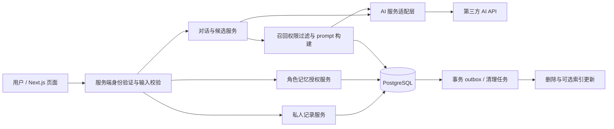

# 未来全栈架构与产品边界

> B2 实现追踪：本文件保留第二阶段 A 的历史设计范围；当前身份、记录与授权实现及未验证边界见 [核心全栈说明](CORE_FULLSTACK.md)。
> 方案状态：设计，未实现。当前只有 Next.js + TypeScript + Tailwind CSS 页面基础；没有 PostgreSQL、AI SDK、身份服务、API 路由或迁移。本阶段不安装这些服务。

## 1. 整体结构与分期

采用模块化单体，避免首版微服务成本。Next.js App Router 负责页面与同源服务端入口，TypeScript 共享校验类型；PostgreSQL 为记录和授权的唯一事实源；模型供应商通过服务器端适配层接入，不能由浏览器直接带密钥请求。

P0-a 只需身份、数据库、私人记录 CRUD、时间线、关键词检索与删除；不需模型。P0-b 才加对话、确认提取、授权记忆与按需召回。关键词搜索首版可用 PostgreSQL 参数化匹配/全文策略，中文分词方案需实测；不用“向量数据库”来装饰架构。P1 数据规模与召回质量支持时再加 `pgvector`，仍以 PostgreSQL 授权结果为准，不把向量索引当权限系统。

## 2. 服务职责

| 模块 | 职责 | 明确禁止 |
| --- | --- | --- |
| 页面与交互状态 | 字段校验、加载、候选暂存、明确权限反馈 | 把禁用 Demo 改为假成功；localStorage 持久保存私人原文 |
| 身份与授权层 | 从可信会话得到 user_id，所有读写绑定 owner | 接受客户端提交的 owner_id；仅靠隐藏按钮保护 |
| JournalService | 版本化记录、时间线、删除、幂等保存 | 私人保存时自动创建长期授权 |
| ConversationService | 当前会话消息、模型流式、停止与失败 | 默认扫描所有历史聊天、跨用户/跨角色上下文 |
| CandidateService | 根据用户选中或明确允许建议的消息生成临时候选 | 将候选自动落库或拿角色猜测当用户事实 |
| MemoryService | 精确版本与角色授权、撤回、检索资格 | 复用已撤回授权，源记录变更后自动重新授权 |
| ReviewService（后置） | 手动时间线；未来选定范围单次 AI 回顾 | 给无数据用户编造经历；把回顾授权扩为长期召回 |
| AIAdapter | 超时、结构化校验、预算、供应商替换 | 在服务端日志或浏览器暴露密钥/原文 |

## 3. 拟定 API 契约与一致性

路由均为未来设计，不是可调用端点。除手动读取外，写请求必须有会话身份、CSRF/同源保护、长度限制与对象归属校验；对象越权统一返回不可访问，不泄露对象存在性。

| 示例接口 | 操作 | 核心约束 |
| --- | --- | --- |
| `POST /api/journal-entries` | 私人保存 | 正文必填、日期已确认、幂等键；不创建 Memory |
| `PATCH /api/journal-entries/:id` | 编辑 | expected_version 乐观锁；同事务撤回旧授权并清摘要 |
| `DELETE /api/journal-entries/:id` | 删除 | 同事务逻辑不可读、清内容、撤回派生授权；幂等 |
| `GET /api/journal-entries` | 时间线/关键词 | 当前用户、稳定游标（事件日期 + 创建时间 + id） |
| `POST /api/conversations/:id/messages` | 对话 | 会话所属、当次处理许可、请求限流、角色固定 |
| `POST /api/candidates` | 提取 | 服务端重查所选消息，临时结果带源 ID 与版本，不保存 |
| `POST /api/memories` | 预览确认授权 | 源记录当前版本、撤销窗口结束；单事务写 Memory 与 GRANT |
| `POST /api/memories/:id/revoke` | 撤回 | 写 REVOKE、清可调用内容、任务失效；保留 JournalEntry |
| `DELETE /api/characters/:id/memories` | 清该角色记忆 | 仅撤回当前用户该角色所有有效授权 |
| `DELETE /api/conversations/:id` | 删聊天 | 清消息，不删除已独立确认的私人记录；返回保留记录数 |
| `POST /api/reviews`（P2） | 单次 AI 回顾 | 用户选范围、许可本次处理、逐条归属校验、不授长期记忆 |

写幂等键以 `(user_id, operation, key)` 唯一，绑定请求摘要，重用同键不同内容返回冲突；仅存请求摘要/结果 ID，不留正文。服务端成功才给成功反馈。乐观冲突返回可理解的“原记录已修改”，重取预览再确认。

候选只在服务端响应与当前页面暂存，不持久化；有效期提案 20 分钟，来源改变/删除即失效。确认时服务端重新检查 message_ids 属于当前会话与用户；签名候选不是绕过身份校验的票据。手动编辑后的正文仍需用户保存确认，不能让模型持有写权限。

## 4. AI 数据流与范围控制

### 正常角色回复

用户发送 → 校验当次处理许可 → 当前会话有限上下文 + 当前角色明确授权的 Memory 摘要 → 再查源版本和撤回状态 → 构建 prompt → 模型 → 标 AI 回复和来源。

不附加用户私人记录全文。没有有效 Memory 时仍可聊天，只用本轮已同意处理的上下文。Memory 是按需候选，不是每次将全部授权记忆发送给供应商。跨角色永不自动共享。

### 候选与私人保存

选定消息 → 提取结构化候选（无 DB 写入）→ 用户改错确认 → JournalEntry 事务保存。AI 输出不触发 MemoryConsent；授权是之后独立的人类动作。详见 [AI 工作流](AI_WORKFLOW.md)。

### 单次回顾例外

用户主动选私人记录做 AI 回顾时，明确一次性处理范围，在该请求内允许使用这些记录；不产生长期 Memory/GRANT。普通时间线/关键词检索不调用 AI。这样既允许回顾，又不默认角色永远可检索私人原文。

## 5. 撤回、删除与后台竞态

权限正确性不等待索引或队列：撤回/编辑/删除请求在 PostgreSQL 同事务改变有效授权、源版本与内容状态，并写 outbox。后续召回查询先过滤，再对选中 ID 复查版本与授权。异步任务载荷只有 ID/版本，不含原文；执行前重新查资格，无资格即丢弃。

生成开始时记录授权版本，完成前再检查；撤回时尝试取消在途生成，并丢弃包含失效记忆的待返回结果。流式已经送达客户端的内容无法追回，不能把“未来不用”描述为所有痕迹已消失。实现时需检查每次继续输出/最终落库资格；[技术测试](AI_WORKFLOW.md) 包含这类并发场景。

不缓存长期召回内容，首版不持久向量副本。未来索引更新以 outbox 版本为栅栏，旧任务不能插回删除/撤回的记忆；索引命中仍需数据库权限过滤。删除聊天令源 message 引用失效，但已确认的私人记录是独立数据，用户要删需显式操作。

### 拟定保留与清理政策（上线前必须评估）

| 数据 | 当前提案 | 用户承诺边界 |
| --- | --- | --- |
| 聊天 | 默认保留 30 天，可更早删除；到期清消息正文 | 不等于永久角色记忆；不是本阶段已有行为 |
| 私人记录 | 用户主动保存后保留至删除 | 默认不供长期角色召回 |
| 授权摘要 | 持续到撤回、删除、来源修改或账号关闭 | 撤回立即停止后续召回，清 live 内容 |
| 临时候选 | 不落库，当前页面或短期请求有效 | 离开/到期丢弃，不自动恢复 |
| 已撤回/失效授权与删除元信息 | 失效/删除后最多 90 天，仅 ID/hash/时间/用途，不保留正文；有效 GRANT 随有效授权保留 | 用于撤回追踪与阻止旧任务恢复；到期清理/去关联，不能提前清掉仍有效的授权依据 |
| 数据库备份 | 拟最长 30 天受限滚动备份 | 删除后在线不可用；备份不保证瞬时逐条擦除；恢复必须重放删除/撤回标记 |
| 产品日志 | 不收原文；操作元信息最多 30 天 | 不包含隐私文本、prompt、回复或密钥 |

供应商的保留和训练政策没有核实，不能套用本表替第三方承诺“零保留”。选型须支持受控日志/训练开关、合适处理协议与地区；否则不开放真实私人输入。删除流程不能靠写一行 SQL 就称全链路删除完成。

## 6. 安全、成本和可观测性

- 数据库读写均有 owner 条件与复合归属约束；RLS 可作防御层，但需要实际验证，不能以框架默认保证用户隔离。
- AI 密钥仅服务端环境变量/托管秘密。正文、日期、引用 ID 用运行时 schema 校验；TypeScript 类型不能信任外部模型输出。
- 角色 prompt 固定，用户内容与召回摘要是数据，禁止指令注入提升权限；模型永远不能调用保存/授权 SQL。
- 每请求限制上下文长度、候选条数、生成预算；超时、服务失败降级手写。首版不做全历史自动总结，成本跟明确请求挂钩。
- 指标只记录事件类型、耗时、结果类别和必要的去标识 ID，不上传文本。研究行为数据和生产遥测分别征得合适同意，不假定研究同意通用。
- 以 request_id 串联失败；记录拒绝、超时、撤回过滤数量，不记录被过滤内容。

## 7. 下一阶段工程验收

P0-a 首先做数据库迁移、身份方案、跨用户访问测试、记录 CRUD、幂等/冲突、时间线与删除闭环。P0-b 才做供应商适配、提取 schema 与事实样例测试、源版本授权、撤回竞态、AI 失败降级。

本阶段仅执行现有 lint/build/typecheck 和文档检查；不能把这些通过说成数据库/AI 隐私测试通过。

关联：[数据模型](DATA_MODEL.md) · [AI 工作流](AI_WORKFLOW.md) · [用户流程](USER_FLOW.md)
