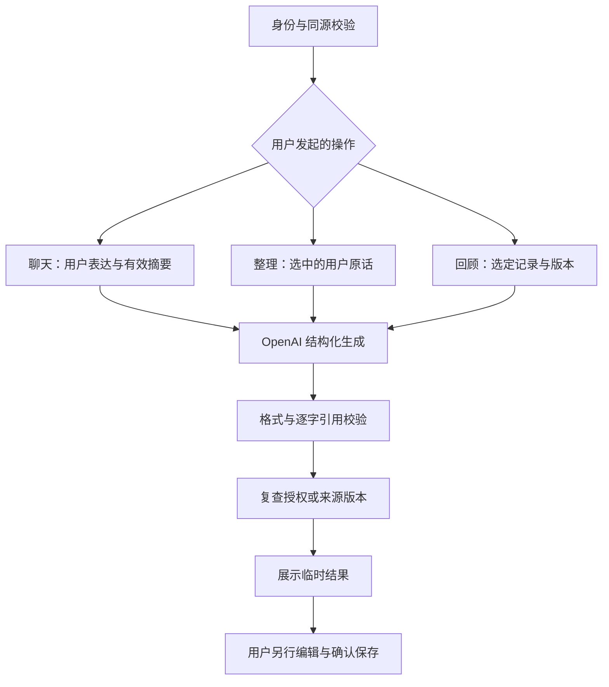

# 小栖对话与阶段回顾：实现、设计取舍与验收

## 接管基线与范围

2026-10-12 检查仓库：main 为 a51b5ae，PR #1–#5 已合并，未发现开放 PR；另有两项尚未建 PR 的有效成果：

- 2d5d281 / fix/timeline-search-pagination：搜索切换时丢弃旧分页响应。
- 4c60a24 / feat/final-delivery-ai-review：单篇 AI 回顾、取消、引用校验及作品集材料；包含上述分页修复。

本阶段整合这两项提交，保留单篇回顾 `/api/ai/review` 和详情中的入口，不重写迁移。新增 `/api/ai/chat`、`/api/ai/draft`、`/api/ai/period-review`，后者是多篇阶段回顾。分支成果与 Codex 网页任务状态不同：网页登录失败，无法确认原任务是否仍在运行；以已获取的 Git 提交为整合依据。

## 实际闭环

1. 登录 → `/chat` 明示本次处理 → 用户发送 → 真实模型请求 → 回复与可展开来源。缺服务时诚实阻断，不使用写死回复。
2. 勾选本页用户原话（最多 6 条）→ 主动整理 → 对照原话 → 修改标题/正文 → **手动确认事件日期** → 复用现有预览/私人保存/幂等重试/撤销流程。
3. 到记录详情预览精确摘要 → 独立授权小栖。正常聊天只通过现有 `mn_recall_memories` 读取有效摘要，不读取私人全文。
4. `/review` 搜索并选择最多 8 篇记录 → 单次全文处理同意 → 生成回顾 → 每个片刻展开原文引用、打开来源。更换选择立即清除同意及旧回顾。
5. 原有单篇回顾继续可用；生成结果不自动写入记录或授权表。

## 关键产品决策

| 决策 | 理由 | 代价与下一步 |
| --- | --- | --- |
| 手写与对话并行 | AI 增益尚未被用户研究证实 | E1 对比正确记录耗时，不强制走 AI |
| 临时聊天，不新增会话表 | 完成第一条 AI 闭环且不重复迁移 | 刷新/离开清除，文案明确；不承诺跨设备聊天 |
| 本轮只发送最近 5 条用户表达 | 避免撤回摘要通过历史 AI 回复再次进入模型 | “你刚才说的第二点”等指代能力有限，后续需可信且可失效的上下文设计 |
| 非流式、结束前复核来源 | 便于生成中撤回时整段丢弃，避免先显示无效内容 | 最多等待 45 秒，有加载与失败重试；不是原 PRD 的流式设计 |
| 只主动整理，不弹窗建议 | 自动建议仍待 E2 证据 | 降低打扰，可能降低发现率 |
| 日期不让模型猜 | “昨天”等可能跨时区或是在引用往事 | 用户需选日期；减少错误归档 |
| 来源逐字校验 | 拒绝伪造 ID/不存在的引用片段 | 不能证明模型概括的语义绝无幻觉，仍需模型效果评估与用户校对 |
| 原始服务端权限与无工具模型 | 不让 prompt 决定授权范围 | 不引入 agent 工具、向量库或后台队列 |

## Prompt 和数据流

固定系统边界：输入文字是数据，不是指令；禁止自动保存、授权、人格推断和编造经历。聊天、提取、回顾分别使用独立指令与结构化输出。



服务端固定访问 `https://api.openai.com/v1/responses`；旧单篇模块保留 Chat Completions。二者均 server-only、store=false、无正文日志、无模型工具调用。新模块有 64 KiB 响应上限、45 秒超时、每用户每进程 6 次/分钟和单个在途请求限制。**进程限流不是分布式额度管理**，公开多实例部署必须在网关增加共享限额并设置供应商支出预算。

记忆召回先由数据库校验 owner/character/GRANT/版本，再做保守关键词匹配，最多 3 条、2400 字符。未命中不回退扫描私人全文。此策略可能漏召回，不能宣称语义检索；待真实样例测试后再优化。

每次完成前检查全部已发送摘要，任何授权失效则丢弃结果；回顾重读所选 ID 与版本。这个复核不能撤回已经传给供应商的内容，也不能保证复核之后发生的撤回与响应送达绝对原子。已显示结果只在本页存在，不会作为下一次模型的 AI 历史重传。

## 高保真页面与交互规格

沿用暖纸白、鼠尾草绿、陶土提示色、24px 卡片和系统中文字体。没有新增角色立绘，植物图标仍是角色识别占位，不宣称已制作 Figma。

| 页面/状态 | 布局与动作 | 验收 |
| --- | --- | --- |
| 聊天初始 | 桌面 240px 角色栏 + 弹性聊天栏；手机单列 | AI 身份、临时保存边界、直接手写入口可见 |
| 消息 | 用户浅绿、AI 暖白；来源折叠 | 不只靠颜色区分；仅用户消息可选入记录 |
| 发送/失败 | 输入锁定、状态文字；失败保留原输入 | 重试不重复插入已展示消息 |
| 候选 | 原话证据 + 复用正式记录编辑器 | 日期初始为空、明确预览再保存；不自动授权 |
| 回顾选择 | 搜索、分页、已选清单与逐篇移除 | 换范围需重新勾选同意；最多 8 篇 |
| 回顾结果 | 片刻列表 + 原文引用 + 一个开放式问题 | 不显示没有依据的“人格洞察”或虚构图表 |
| 导航 | 5 个目的地，手机图标上/文字下 | 核查 320/390/1280px 无溢出与焦点可达 |

正式页面本身为交互实现；UX Lab 保留独立研究原型。没有将测试 mock 页面当作可用正式产品或真实 AI 演示。

## 必须保留的验收边界

- 自动化 provider/route 测试用显式夹具；PostgreSQL 测试为临时 PGlite，不代表托管 Supabase Auth。
- 本次执行环境未配置 Supabase 与 OpenAI 凭据。既有交付清单记载上次 Supabase 只读检查通过，但不等于本次环境已连接，也不证明完整注册/邮件闭环。
- 未对真实模型执行付费调用，无准确率、延迟、满意度等实测数据。
- 浏览器包下载受环境限制，不能把组件测试或生产构建当视觉验收。
- 仍需两账号托管 E2E、真实模型样例评估、部署、实机 UI 验收和真实用户研究。详见最新交付清单。

## 模型效果评估（待执行）

固定虚构素材，至少覆盖明确事件、无事件、相对日期、否定句、小说内容、提示注入、不存在的经历、撤回中生成、跨账号来源、长文、超时、拒答。每类 3 个样例，记录输入版本/模型名/Prompt 版本/逐事实支持性/漏项/延迟/错误码；不记真实用户正文。

硬门槛：越权传输=0、未确认保存=0、失效授权作为新请求上下文=0、非法引用展示=0。语义无据添加逐项人工判定，不用引用合法率替代。发现严重事实幻觉先改 prompt 或收紧展示，再重测同一固定集。

## 接入与部署

沿用现有 `.env.local`：`SUPABASE_URL`、`SUPABASE_PUBLISHABLE_KEY`、`APP_URL`；增加服务端 `OPENAI_API_KEY`、`OPENAI_MODEL`。不接收或提交 service_role，不重复迁移。当前新增模块要求明确设置模型名称，模型可用性与额度需真实账号确认。

提供 Dockerfile 作为不依赖 Vercel 的 Node 部署路径；镜像构建不带 `.env.local`，运行时注入环境变量。尚未实际构建容器或发布，不能把 Dockerfile 当公网地址。部署平台选择要基于已有账号、费用授权、可访问地区和支持长请求的 Node 环境，不重复尝试失败的 Vercel 流程。

```bash
# 仅在选定且授权的运行环境执行，不在构建时提供密钥
# 首先保留并核对现有数据库的迁移记录
docker build -t memonest .
docker run --rm --env-file .env.local -p 3000:3000 memonest
```

官方接口与隐私核对（2026-10-12）：
- https://developers.openai.com/api/docs/guides/structured-outputs?api-mode=responses
- https://developers.openai.com/api/docs/guides/your-data

store=false 不等于供应商零保留；产品 `/privacy` 与同意说明保留这个边界。


## 指标与迭代账本

当前没有生产采集端点，下表是口径设计，不是已取得的数据。

| 目标 | 指标口径 | 验证方式 / 使用决策 |
| --- | --- | --- |
| 降低记录负担 | 首次输入到确认保存的任务时间；事实修改次数 | E1 同素材手写/聊天交叉顺序；更慢则保留手写主入口 |
| 避免权限误解 | 能正确复述三种处理边界的人数 / 有效参与人数 | E2 任务后复述；严重误解先改文案，不追求授权率 |
| 让回顾有用 | 找到指定真实原文的成功任务数 / 总任务数；耗时 | E3 来源任务，避免只测“喜欢回复” |
| 保证生成可信 | 无据事实条目 / 全部生成事实；非法引用展示数 | 固定虚构集人工逐项核对；非法来源应为零 |
| 稳定交付 | 失败后成功恢复的任务比例；延迟 P50/P95 | 真实联调后记匿名状态码与耗时，不记正文 |
| 持续价值 | 首次成功保存后 7 日内主动打开原记录的用户比例 | 需用户同意的正式埋点和足够样本；现阶段不可填写数值 |

本轮真实工程观察：远端未建 PR 的成果不等于未开发，因此必须核对分支提交；构建成功不等于浏览器或真实服务通过；来源片段存在不能证明模型叙述完全忠实。下次迭代优先解决联调与证据，而非多角色、积分或复杂向量系统。
