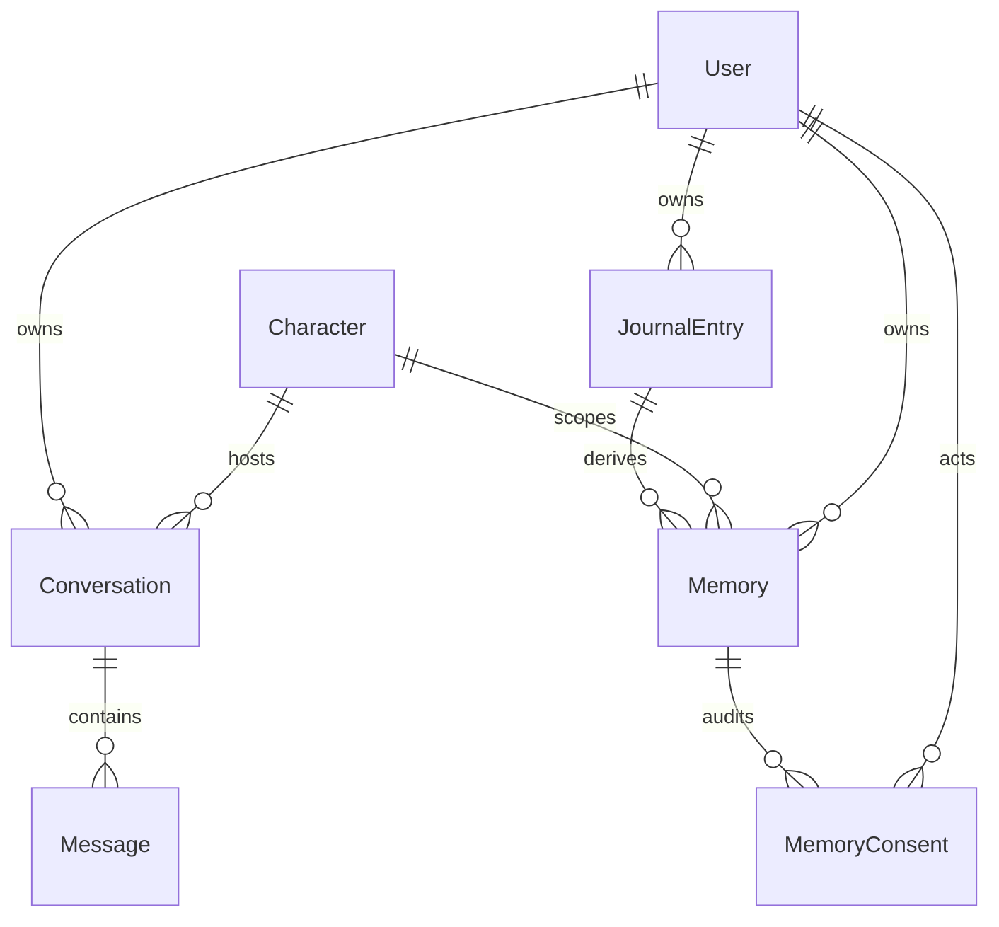
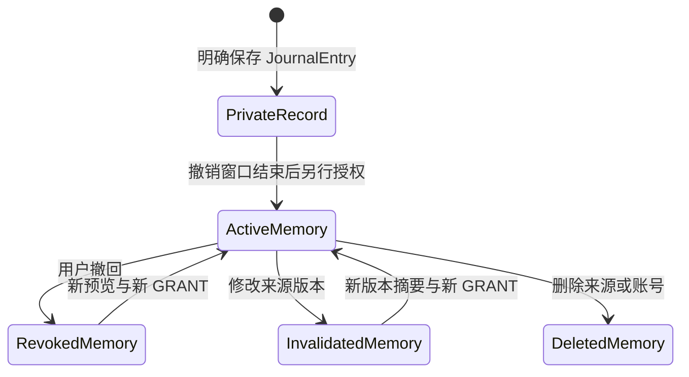

# 实体关系、授权与数据生命周期

> B2 实现追踪：本文件保留第二阶段 A 的历史设计范围；当前身份、记录与授权实现及未验证边界见 [核心全栈说明](CORE_FULLSTACK.md)。
> 未来 PostgreSQL 模型提案，未生成迁移、ORM 模型或种子数据。下面字段、约束与状态均未实现。私人生活记录和角色长期记忆必须是不同实体，不能在 JournalEntry 上加一个默认 true 的“AI 可用”字段代替授权。

## 1. 关系概览

JournalEntry 可手写（无聊天来源）或由候选确认生成；Message 与 JournalEntry 的来源引用为辅助关联，不表示两者同生同灭。私有记录能自己查看，但只有 Memory 的确切内容版本被授权后才可供指定角色召回。

## 2. 实体字段

所有业务 ID 使用 UUID；存储时间 UTC，界面根据 User 的时区解释事件日期。`event_date` 用日期型而非 UTC 午夜时间戳，避免跨时区漂移。

| 实体 | 关键字段 | 规则 |
| --- | --- | --- |
| User | id、auth_subject、display_name、timezone、ai_processing_policy_version、ai_processing_accepted_at、suggestions_enabled（默认 false）、created_at、deleted_at | 不设计明文密码字段；身份供应商待选；当次处理许可不等于 MemoryConsent |
| Character | id、slug、name、persona_version、persona_definition、status、created_at | 首版小栖；服务端控制定义；角色版本不扩大已授记忆范围 |
| Conversation | id、user_id、character_id、suggestion_processing_accepted_at、suggestion_policy_version、retention_until、created_at、deleted_at | 角色建立后固定；按会话说明处理范围；拟 30 天保留 |
| Message | id、user_id、conversation_id、role（user/assistant）、content、version、status、client_request_id、created_at、deleted_at | role 由服务端决定；未完成 AI 回复不能当用户事实；版本用于候选失效检测 |
| JournalEntry | id、user_id、title（可空）、body、event_date、tags、origin（manual/chat_confirmed）、source_conversation_id（可空）、source_message_refs（ID+version 列表，可空）、version、undo_until、created_at、updated_at、deleted_at | 私人，非角色上下文；活记录正文非空，已删行允许清空；引用不含额外源文本副本；标题为空用首句展示 |
| Memory | id、user_id、character_id、journal_entry_id、source_version、summary、content_hash、version、status（active/revoked/invalidated/deleted）、created_at、invalidated_at | 只有用户确认的摘要；最多一条每源记录每角色的有效记忆；撤回/失效时 summary 清空，仅留必要元信息 |
| MemoryConsent | id、user_id、memory_id、action（GRANT/REVOKE）、grant_id（撤回目标）、memory_version、content_hash、source_version、character_id、purpose（role_recall）、policy_version、created_at、reason | 追加事件；精确版本、角色、用途；无原文副本；模型不得写入 |

User 的接受时间仅表示某版 AI 处理说明；每次服务请求还需验证当前操作许可和范围。故事卡的单次回顾未来用请求限定范围，不通过改写 `suggestions_enabled` 或 MemoryConsent 来实现。是否单独引入 ProcessingConsent/ReviewRequest 实体，需真实供应商与合规要求确定；当前不把当次处理授权错误塞入长期记忆实体。

`source_message_refs` MVP 可用受校验 JSONB，服务端验证每个 ID/版本及归属；若需要高效关联与完整 FK，再规范化为 JournalEntrySource 表。两种方案不混用为已实现架构。删聊天时移除/失效引用，不清已确认私人记录；此类来源元信息清理不改正文内容版本，不能反向扩大授权。用户编辑标题、正文、日期或标签则版本递增并使旧授权失效。

## 3. 约束与索引

- `(user_id, id)` 复合唯一供同 owner 关系引用：Conversation → Message、JournalEntry → Memory、Memory → MemoryConsent；禁止一个用户的记忆引用另一个用户的记录。
- Conversation 固定 character_id；MemoryConsent 的 character_id/version/hash 必须与目标 Memory 一致，不能只信客户端字段。
- `auth_subject`、Character.slug 唯一；`(user_id, conversation_id, client_request_id)` 保证消息幂等。
- 首版 Memory 对 `(user_id, journal_entry_id, character_id)` 设“status=active”部分唯一索引，避免重复有效摘要；grant 与 memory 创建在同事务。
- 同一 GRANT 最多一个 REVOKE，`grant_id` 引用 GRANT、拥有者相同；并发撤回幂等。不通过删除审计事件表示撤回。
- JournalEntry 索引 `(user_id, event_date DESC, created_at DESC, id)` 用于稳定游标；活记录过滤 deleted_at，关键词使用参数化查询，中文效果待测。
- Memory 索引 `(user_id, character_id, status)`，读取时联表查源记录版本和授权；不是仅靠状态布尔值。
- 授权/删除元信息保留期结束后按关联顺序清理，不能保留一个可追溯身份的“永久审计档案”。

## 4. 有效授权的判定

召回资格必须同时满足：

1. 当前可信会话 user_id 与 Memory/JournalEntry/GRANT 的 owner 一致。
2. 当前会话角色等于 Memory/GRANT 的 character_id。
3. Memory.status 为 active，源 JournalEntry 未删除，source_version 等于当前 JournalEntry.version。
4. 存在对应 purpose=role_recall 的 GRANT，其 memory_version/content_hash/source_version 与 Memory 内容完全相同；没有关联 REVOKE。
5. 当前用户/角色可用；生成请求尚未被取消；再次输出前资格仍有效。

`can_recall` 查询结果才是权限，不把“用户开过建议”“聊过这件事”“源记录存在”或“检索相似度高”当授权。不存某种自动提升到“全量记忆”的总开关。

## 5. 状态与版本转换

这是产品状态示意，不是把 JournalEntry 和 Memory 存成同一行。重新授权建议创建新 Memory 版本/新 GRANT，旧事件不改成已授权；已清内容不能靠旧审计 hash 恢复。

### 事务示例（设计约束）

- 私人保存：验证正文/日期/归属 → 幂等检查 → 插入 JournalEntry，version=1、undo_until=服务端保存时间+10秒 → 返回 ID；零 Memory/GRANT。
- 授权：锁源记录 → 验证未删、version、undo_until 已过 → 展示过且用户明确确认的摘要/hash → 创建 Memory 与 GRANT → outbox。不能让后端根据勾选默认值自动授予。
- 修改：锁源记录并查 expected_version → 更新正文、version+1 → 将该记录派生的 active Memory 失效/清 summary → 追加 REVOKE(reason=source_changed) → outbox。
- 撤回：锁 Memory → 追加 REVOKE → status=revoked、清 summary → outbox；不更新 JournalEntry 正文。
- 删除记录：逻辑标 deleted_at、清 title/body/tags/来源引用 → 撤回/清所有派生摘要 → outbox；候选或旧后台任务版本失效，不能重建。

细粒度权限与内容清理用同事务；向量清理可异步，不能把权限阻断延后。

## 6. 删除、留存与来源独立性

在线删除立即不可读取，内容字段清除；从删除/失效之日起保留最多 90 天的最小 tombstone（ID、版本、删除时间）和已失效授权元信息以防旧任务重放，不保留正文/摘要。有效 GRANT 是权限依据，随有效授权保留，不套用失效后的 90 天清理；撤回后才启动清理计时。备份拟最长 30 天、恢复重放撤回与删除，供应商处理另行评估，详见 [保留策略](ARCHITECTURE.md)。法域与合法审计要求未确定，上线前必须确认并明确告知用户。

删除聊天清 Message.content 和会话上下文，不自动删已确认的 JournalEntry/Memory：它们是用户另行保存/授权的独立内容。删除前显示此区别并给记录管理入口。删除原记录则必须删除/撤回所有派生 Memory。清角色记忆只影响该角色的 Memory/GRANT，不删私人记录或其他角色未来的授权。

本阶段不创建实际用户或生活数据，也不做模拟数据迁移。

## 7. 未来必须验证的例子

| Given / When | Expected |
| --- | --- |
| 只有私人记录，正常聊天召回 | 不包含该记录，除非用户当前显式选择做一次处理 |
| 用户 A 提交用户 B 的 source ID | 拒绝，不能据 ID 存在泄露 B 的内容 |
| 小栖授权、未来切换另一角色 | 另一角色不可召回 |
| 源 v1 已授权，编辑为 v2 | v1 即刻失效，v2 不自动授权 |
| 授权已撤回，旧索引/任务返回命中 | 数据库资格过滤排除，任务不能恢复 summary |
| 保存请求重复、内容相同 | 返回同一 JournalEntry，不插两条 |
| 同幂等键换正文 | 冲突，不覆盖原记录 |
| 删除聊天但已保存私人记录 | 私人记录保留，源聊天不可打开，授权记忆按独立规则管理 |

关联：[AI 工作流](AI_WORKFLOW.md) · [PRD](PRD.md) · [用户流程](USER_FLOW.md)
