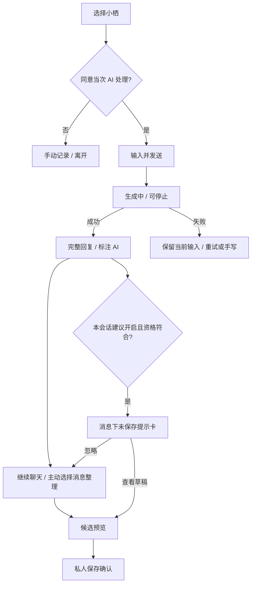

# 用户流程与状态转换

> 最新实现增量（2026-10-12）：聊天、候选整理、多篇阶段回顾与本轮设计取舍见 [COMPANION_DELIVERY](COMPANION_DELIVERY.md)。保留本文件历史方案；非流式临时聊天、五目的地导航等当前差异以增量文档为准。真实研究与模型效果未验证。

> B2 实现追踪：本文件保留第二阶段 A 的历史设计范围；当前身份、记录与授权实现及未验证边界见 [核心全栈说明](CORE_FULLSTACK.md)。
> 第二阶段 A 未来流程规格，尚未实现。当前四个页面中的按钮仍为禁用状态；本阶段不把此流程变成已完成能力。故事编号对应 [PRD](PRD.md)。

## 1. 首次进入与角色选择（U1、U4）

入口 `/` → 产品用途与“AI 不是人类”说明 → 两个平行选择：“认识小栖”“直接记录”。前者展示唯一原创角色小栖（设定与预期语气），可以选择或跳过；不展示不可用角色作假选择。

手动记录不需 AI 许可。真正启用聊天前明确说明：本轮输入会交第三方模型处理、聊天保留拟为 30 天、不会默认形成长期记忆；可拒绝并返回手动记录。正式持久化前再由身份系统确保私人数据有所属账号，本阶段不实现登录。

“允许本会话给出记录建议”是独立默认关闭的开关；说明分析范围是当前会话内明确启用后的消息，可关闭。它不授予角色长期记忆。

## 2. 角色聊天（U2、U7、U8）

停止或失败的半段回复不得被自动转成事实记录；候选来源首版只用用户选定/允许处理的用户消息，不用角色猜测补事实。重试发送带幂等键避免生成/记录重复。聊天输入不是记录，未保存候选不是记录。

## 3. 用户主动记录（U1、U8）

`/journal` → 正文输入（必填）、标题（可空）、日期（默认当天、可修正）、可选标签 → 预览 → “保存为私人记录”。不要强制心情打分或选择角色。

提交中防重复点击；服务端成功后才反馈“已保存给你自己，尚未授权角色使用”，进入 10 秒撤销窗口；失败保持当前页面内容、提供重试，不自动持久化到 localStorage。导航离开未保存输入时有确认“离开将丢失当前内容”；不把浏览器临时草稿当云端已保存。

## 4. AI 候选、校对与保存（U2、U3）

暂定 B：“未保存草稿”卡 → 用户查看 → 原消息与候选对应 → 编辑标题/正文/日期 → “保存为私人记录”或“放弃”。日期不明必须提示用户确认，不由 AI 填入推测日期。候选中感受仅取用户明说的内容。

三种提示规格和限频见 [E2](UX_EXPERIMENTS.md#e2)。忽略不保存、不授权、不追加劝说；会话内至多一个建议。C“整理为记录”始终可用；A 弹窗只作为研究原型，不进入当前代码。

| 状态 | 用户操作 | 持久数据 | 下一步 |
| --- | --- | --- | --- |
| 未提取 | 主动选消息或启用建议 | 仅已有聊天消息 | 当次处理检查 |
| 提取中 | 停止 / 等待 | 不创建 JournalEntry/Memory | 失败降级手写 |
| 候选未保存 | 编辑 / 放弃 / 私人保存 | 候选只在临时视图；不落库 | 用户确认后写记录 |
| 私人保存中 | 等待 / 失败重试 | 成功事务才创建 JournalEntry | 失败保留草稿，幂等重试 |
| 私人已保存、可撤销 | 10 秒内撤销 | 有 JournalEntry，无授权 Memory | 删除或进入详情 |
| 撤销窗口结束 | 查看记录 / 可选长期授权 | 私人记录保持 | 另开角色授权面板 |

候选放弃只清理候选，不删聊天。私人保存撤销等价删除新记录，即使超过提示窗口也可在详情删除。

## 5. 单独授权与撤回（U4、U5）

私人记录详情 → “让小栖记住这条” → 显示具体可调用摘要、源记录版本、角色、用途“后续聊天按需调用”、没有默认到期（持续到撤回/删除/源内容改变） → 确认授权或取消。

未经点击确认不写 MemoryConsent。授权不能发生在私人保存的 10 秒窗口内，界面显示“稍后可在详情授权”；服务端也检查。拒绝不影响私人记录。来源全文并不因此自动交给模型；只有授权摘要进入召回。

撤回 → 说明“保留私人记录，角色后续不再调用这条；已生成内容不会自动消失” → 确认 → 服务端撤销成功再反馈；若失败不能显示已撤回。之后可重新预览并授权，生成新授权版本，不复用旧撤销记录。

## 6. 编辑、撤销与删除（U5）

| 操作 | 需要明确告知 | 后果 |
| --- | --- | --- |
| 编辑私人记录 | 保存修改会撤销依赖旧版本的角色记忆；新内容需重新授权 | JournalEntry 版本增加，旧 Memory 失效、内容清理；不自动重新授权 |
| 保存后撤销 | 删除本次新记录；窗口 10 秒 | 记录退出时间线，后续可重新写 |
| 撤回单条角色记忆 | 不删原私人记录、不删历史回复 | 召回立即阻断、索引清理 |
| 清空小栖的角色记忆 | 只清该角色可调用记忆，不删生活记录或聊天 | 所有该角色授权撤回；别的角色未来不受影响 |
| 删除私人记录 | 同时移除由这条记录派生的角色记忆；不可通过撤销提示恢复 | 记录不可读，相关授权失效、派生内容清理 |
| 删除聊天 | 删除消息/会话不等于删除已经确认保存的生活记录 | 显式展示独立记录仍保留，可跳转管理；不保留源消息正文副本 |

删除不同于撤回，确认弹层标题写清对象，不用含糊“清空记忆”。删除聊天若有关联记录，提示“你之前保存的 N 条私人记录仍会保留”，N 来自服务端而非模拟数。聊天删除后源引用显示“来源聊天已删除”，私人记录本身是用户确认后的独立文本。

请求删除时立即阻断读取/召回，实际内容清理与备份周期见 [架构](ARCHITECTURE.md)。提交中的生成也必须取消或丢弃旧授权输出，不能再次写回。

## 7. 时间线与生活回顾（U6、U7）

`/memories` → “私人记录”（默认）/“角色记忆”（权限管理），不是含糊混合列表。

私人记录：按用户事件日期降序 → 日期范围/关键词 → 卡片 → 记录详情。相同日期按创建时间稳定排序；原文关键词搜索属于普通数据库操作，不需 AI 授权。没有数据时指向记录入口；没匹配时可清筛选。

角色记忆：展示当前角色、授权摘要、来源、授权时间、撤回入口；只列有效可用授权，不把私人记录数量当记忆数量。失效状态给出原因并链接原记录。

主题回顾 P1：先用用户可改标签；AI 故事卡 P2：用户选日期/记录范围 → 单次处理授权 → 生成 → 每个事实可开来源 → 可放弃。保存故事卡如果未来开发，应是新私人记录，不能默认形成角色记忆；当前没有定义其数据库实体或上线时间。

## 8. 跨流程异常与反馈

- 加载：明确操作对象、可停止、保留导航；不显示假的进度百分比。
- 提取无事件：提示“未找到可确认的具体经历”，提供手写；不强制制造候选。
- 校验失败：在正文/日期字段解释，焦点移到错误摘要，保留其余输入。
- 网络/API 错误：区别“未保存”“未确认撤回”“生成失败”，保留重试与手动路径。
- 会话过期：不泄露内容到其他账号；重新认证后返回同一操作，但不跨账号恢复临时输入。
- 权限改变：原详情不可用或版本已变时刷新授权预览；不能在旧候选上直接授权。
- 关键反馈不能仅靠颜色或短暂 toast；保存/授权/删除状态在详情同步可查。

关联：[设计系统](DESIGN_SYSTEM.md) · [数据模型](DATA_MODEL.md) · [AI 工作流](AI_WORKFLOW.md)
