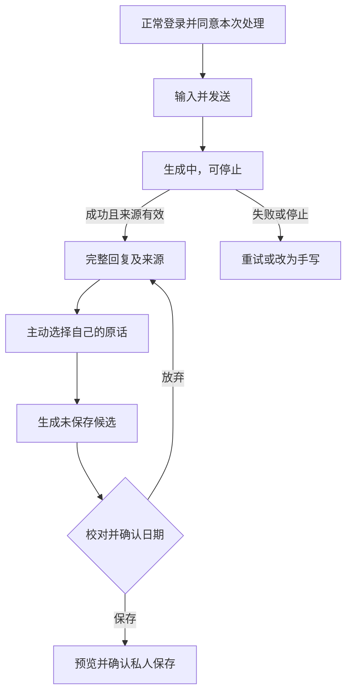

# MemoNest｜用户流程与状态

更新：2026-10-12。本文替换旧阶段的未来流程描述，只记录当前实现；不包含尚未实现的自动建议、持久聊天或清空全部角色记忆。需求依据见 [PRD](PRD.md)，验收结果见 [README](../README.md)。

## 1. 首次进入

首页理解产品与 AI 身份 → 选择聊天或直接记录 → 正常注册/登录。手写无需 AI 许可；聊天需明确同意当次处理。只有原创角色小栖，不展示不可用多角色选项。

## 2. 聊天与整理

只整理用户所选原话，不用 AI 回复补充事实。候选与聊天留在当前页面，刷新或离开不保证恢复。生成不创建生活记录或记忆授权；停止后的晚到结果不能作为完成结果展示。

## 3. 直接记录与私人保存

`/journal` → 输入正文、可选标题及日期 → 预览 → 确认保存。服务端成功才显示已保存。失败保留本页草稿并重试，同一幂等键避免重复写入。

保存后有 10 秒撤销窗口，撤销等价删除新记录。窗口结束仍可进入详情删除；长期授权需在窗口结束后另行确认。未保存内容不被当作已持久化数据。

| 状态 | 数据与下一步 |
| --- | --- |
| 编辑中/候选未保存 | 页面临时内容；可修改或放弃 |
| 保存中 | 等待服务端结果，不提前显示成功 |
| 保存失败 | 保留草稿，允许重试 |
| 私人已保存 | 有生活记录；默认没有角色授权 |
| 授权已确认 | 角色可召回具体摘要及当前版本 |

## 4. 授权、撤回与来源修改

记录详情 → 预览具体摘要、角色及用途 → 明确确认授权。取消不影响私人记录；普通聊天只检索当前有效授权摘要。

| 动作 | 后果 |
| --- | --- |
| 撤回一条记忆授权 | 私人记录保留，旧授权不再供后续召回 |
| 修改授权摘要 | 创建新的版本/许可，不扩大为全文授权 |
| 编辑原记录 | 旧来源版本的记忆失效，新内容需重新授权 |
| 删除原记录 | 原记录不再可读，派生记忆失效 |
| 生成期间来源或许可变化 | 来源复核失败，丢弃本次生成结果 |

撤回不能收回已经传给服务商或已经展示的内容；界面只在服务端操作成功后反馈撤回成功。

## 5. 找回与阶段回顾

时间线/关键词检索 → 选择最多 8 篇记录 → 确认本次全文处理范围 → 生成阶段回顾 → 展开逐字引用并打开来源。改变选择后重置同意与旧结果。

回顾不自动保存，不新增长期授权；内容不足或来源无效时不生成虚构人生经历。旧单篇回顾在详情页独立发起，使用已有接口契约。

## 6. 异常与身份变化

缺配置明确阻断，不提供假回复或假持久化。网络失败、模型拒绝、超时和格式错误给出安全反馈，可重试或手写。账号变化时清除旧客户端私有状态，操作账号不匹配时拒绝请求。

UX Lab 独立使用虚构材料和固定脚本，页面展示不能证明真实模型调用或数据库保存。
